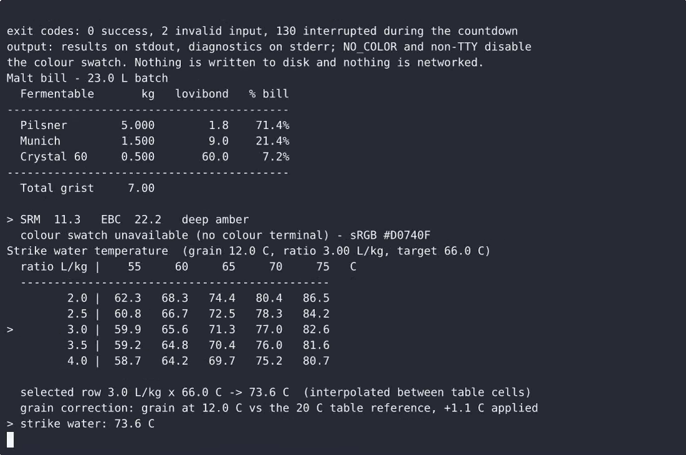
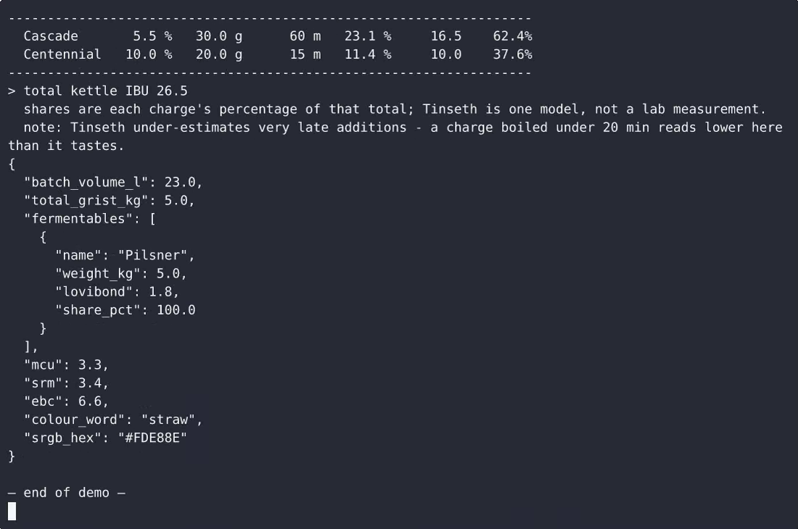

# Grainwell — single-file CLI malt bill, mash timer and IBU calculator — complete Full-stack app command-line tool example app

A Full-stack app command-line tool, open-source and ready to self-host: that's **Grainwell — single-file CLI malt bill, mash timer and IBU calculator**. Grainwell is a single-file, standard-library-only Python command-line tool for all-grain brewers working in metric: `grainwell bill` builds a malt bill from typed fermentables (kg + lovibond) and reports the beer colo…. Grainwell — single-file CLI malt bill, mash timer and IBU calculator ships complete — source, design assets, seed data — under the Apache-2.0 license; no cloud account needed. [Remix Grainwell — single-file CLI malt bill, mash timer and IBU calculator on cenius.ai](https://cenius.ai/marketplace/p/grainwell-single-file-cli-malt-bill-mash-timer-and-ibu-calculator?ref=gh&utm_campaign=grainwell-single-file-cli-malt-bill-mash-timer-and-ibu-calculator-webapp) for a custom build.


[](LICENSE)  [](https://cenius.ai)

[](https://cenius.ai/marketplace/p/grainwell-single-file-cli-malt-bill-mash-timer-and-ibu-calculator?ref=gh&utm_campaign=grainwell-single-file-cli-malt-bill-mash-timer-and-ibu-calculator-webapp)

> **▶ [Open & edit in cenius.ai](https://cenius.ai/marketplace/p/grainwell-single-file-cli-malt-bill-mash-timer-and-ibu-calculator?ref=gh&utm_campaign=grainwell-single-file-cli-malt-bill-mash-timer-and-ibu-calculator-webapp)** — one click to an editable workspace: describe changes in plain English, get an instant preview, one-click deploy and host. Modifications made on the platform come with full rebrand & relicense rights.

_Local clone? See [Quick start](#quick-start) below. cenius.ai is the zero-setup path._

## Demo


📽 **[Watch the walkthrough](https://cenius.ai/marketplace/p/grainwell-single-file-cli-malt-bill-mash-timer-and-ibu-calculator?ref=gh&utm_campaign=grainwell-single-file-cli-malt-bill-mash-timer-and-ibu-calculator-webapp)** — plays on cenius.ai · [MP4 file](.github/media/demo.mp4)

## Screenshots

 

## Usage guide

Four views, three calculators. Every state each one can be in is listed below
with the command that reaches it. Output shown here is real output, piped (so no
colour) unless the swatch is mentioned.

Ranges you can rely on: `--volume` 0.5-200 L, lovibond 0-600, malt weight > 0 kg,
`--ratio` 1.5-5.0 L/kg, mash target 30-80 °C, grain temperature 0-40 °C, step
hold > 0 and ≤ 600 min, hop alpha 0-25 %, hop weight > 0 g, boil time 0-300 min,
boil gravity 1.000-1.150. Out-of-range input names the flag, states the range and
exits 2.

---

### 1. `grainwell bill` - malt bill and colour preview

```
$ python3 grainwell.py bill --add "Pilsner,5,1.8" --add "Munich,1.5,9" --add "Crystal 60,0.5,60" --volume 23

Malt bill - 23.0 L batch
  Fermentable       kg   lovibond   % bill
------------------------------------------
  Pilsner        5.000        1.8    71.4%
  Munich         1.500        9.0    21.4%
  Crystal 60     0.500       60.0     7.2%
------------------------------------------
  Total grist     7.00

> SRM  11.3   EBC  22.2   deep amber
  sRGB #D0740F
```

Each `--add` is `"name,kg,lovibond"` and repeats as many times as your grist
needs (up to 50 comfortably). The colour is Morey: malt colour units are
`Σ(lb × lovibond) ÷ batch gallons`, computed from the metric inputs you typed,
then `SRM = 1.4922 × MCU^0.6859`. EBC is `SRM × 1.97`.

_Full guide: [`USAGE.md`](USAGE.md)_

## Features

- Malt bill builder with lovibond colour preview
- Mash step timer from a strike temperature table
- Hop bitterness calculator with Tinseth and typed alpha acids

## Quick start

```bash
./install.sh   # installs dependencies + seeds demo data
```

See [`INSTALL.md`](INSTALL.md) for full setup and usage instructions.

## Architecture

Full-stack app project, delivered as a complete runnable codebase (15 files). Top-level layout: `tests/`. One command (`./install.sh`) covers dependency setup and demo-data seeding. Installation walkthrough: [`INSTALL.md`](INSTALL.md).

## FAQ

### What does it take to self-host Grainwell — single-file CLI malt bill, mash timer and IBU calculator?

Clone this repository and run `./install.sh`, then start the app as described in [`INSTALL.md`](INSTALL.md). Grainwell — single-file CLI malt bill, mash timer and IBU calculator is fully self-hostable — no external services are required to try it.

### Can I use Grainwell — single-file CLI malt bill, mash timer and IBU calculator in a commercial project?

Yes — it ships under the Apache-2.0 license, which permits commercial use, modification and redistribution. The full text is in [LICENSE](LICENSE).

### Which technology stack does Grainwell — single-file CLI malt bill, mash timer and IBU calculator use?

The app is built with Full-stack app. What you see in this repo is the full production source, demo data included. Highlights include hop bitterness calculator with Tinseth and typed alpha acids.

### What if I want to add features to Grainwell — single-file CLI malt bill, mash timer and IBU calculator without coding?

Yes — [load it on cenius.ai](https://cenius.ai/marketplace/p/grainwell-single-file-cli-malt-bill-mash-timer-and-ibu-calculator?ref=gh&utm_campaign=grainwell-single-file-cli-malt-bill-mash-timer-and-ibu-calculator-webapp), describe the change in plain English, and you get back a fresh build with your modification applied.

### Is white-labeling Grainwell — single-file CLI malt bill, mash timer and IBU calculator allowed?

Yes. The MIT license lets you remove the original branding and ship under your own name. For a guided approach, [remix it on cenius.ai](https://cenius.ai/marketplace/p/grainwell-single-file-cli-malt-bill-mash-timer-and-ibu-calculator?ref=gh&utm_campaign=grainwell-single-file-cli-malt-bill-mash-timer-and-ibu-calculator-webapp): you get a fresh build with full rebrand and relicense rights.

## License & rebranding

Released under the [Apache License 2.0](LICENSE) (© 2026 Cenius AI) — free for personal and commercial use. The Cenius name/logo are trademarks (see NOTICE).

**Need a customized version?** [Remix this app on cenius.ai](https://cenius.ai/marketplace/p/grainwell-single-file-cli-malt-bill-mash-timer-and-ibu-calculator?ref=gh&utm_campaign=grainwell-single-file-cli-malt-bill-mash-timer-and-ibu-calculator-webapp) — modifications made on the platform come with **full rebrand & relicense rights** over your derivative.

## Built with cenius.ai

This entire application — code, design, seeded demo data — was generated on **[cenius.ai](https://cenius.ai)** from a plain-English description.

- 🚀 [Build your own app on cenius.ai](https://cenius.ai)
- 🎛️ [Remix Grainwell — single-file CLI malt bill, mash timer and IBU calculator on the marketplace](https://cenius.ai/marketplace/p/grainwell-single-file-cli-malt-bill-mash-timer-and-ibu-calculator?ref=gh&utm_campaign=grainwell-single-file-cli-malt-bill-mash-timer-and-ibu-calculator-webapp) — open it in a workspace, prompt for changes, and ship your own version.

More open-source apps: [the Cenius-ai catalog](https://github.com/Cenius-ai) · [showcase index](https://github.com/Cenius-ai/showcase)
